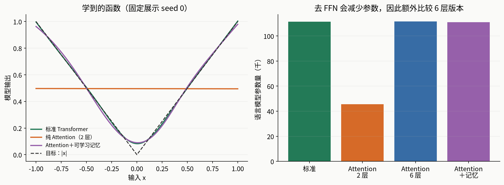

# 纯 Attention，好奇心小实验

目的很简单：亲手看看去掉独立 FFN 后，网络还能学会什么。这不是论文复现，也不以提出新架构为目标。

**实际结果：**两层纯 Attention 在三次运行中都答对了全部 4096 道临时查表题；字符语言模型也能学习，但这次标准 Transformer 更好。单 token、无归一化时，纯 Attention 则无法拟合取绝对值函数。全部 33 次运行，包括没有学好的设置，都保留在仓库中。



完整数字、边界与解释见 [RESULTS.md](RESULTS.md)。

## 比较哪些模型

| 版本 | 核心结构 | 用途 |
|---|---|---|
| `standard` | 2 层：Attention + GELU FFN；FFN 中间宽度 4d | 常规基线 |
| `attention` | 2 层：只有 Attention，没有独立 FFN | 直接删除 FFN 的对照 |
| `attention_matched` | 6 层：只有 Attention，没有独立 FFN | 补回近似相同的参数量 |
| `memory` | 2 层：Attention 额外读取可学习的 key/value | 用 Attention 承担更多特征计算 |

序列任务均为宽度 64、4 个头，保留残差、LayerNorm、输入 embedding、位置 embedding 和线性输出头。**这里的 Attention-only 是没有独立 FFN，不是把所有非线性操作都删除。**记忆只加入 key/value，不成为额外的 query 或输入 token。每个头有 256 个记忆槽，因此新增参数接近被删除的 FFN。

`memory` 是受 Sukhbaatar 等人启发的简化实现，没有照搬其 adaptive span、相对位置编码、优化器或语言模型设置。

## 三个任务

1. **取绝对值。** 输入单个连续数 x∈[-1,1]，输出 |x|。使用宽度 32、2 层，刻意关闭全部归一化；输入与输出映射均为仿射映射。普通单 token attention 此时也是仿射映射，无法拟合 V 形函数。残差保留。这个任务只检验上述受限结构，不能据此推广到含 LayerNorm 的模型。
2. **临时查表。** 每道题给出 6 组不同 key 与随机 value，再给一个 query key，预测对应 value。16 种 key、8 种 value；配对每个 batch 重新随机生成。输入包含题目和候选 value，末尾不包含答案标签。独立生成 4096 道固定评估题，随机猜中率 12.5%。
3. **字符语言模型。** 从零训练小型模型，预测 Tiny Shakespeare 文本下一个字符。按原始顺序切分：前 90% 训练，后 10% 评估，窗口不跨边界。每个窗口 64 字符，评估固定的 65536 个字符目标。指标 bits/字符 越低越好，表示模型分配给真实下一个字符的概率更高。

三组随机种子为 0、1、2。每项任务各版本看到相同训练数据流，步数、batch、学习率日程一致；最后一步模型作为结果，不按评估分数挑 checkpoint。执行顺序按种子轮换。训练设置在运行前保存到 `results/protocol.json`，包括代码和数据 SHA-256。

## 已验证的关键点

- 四种模型都通过“修改后文不能影响前文表示”的因果掩码检查，包括可学习记忆版本。
- 检查查表数据生成器的标签与实际输入配对一致。
- 检查所有可学习记忆 key/value 都收到非零梯度。
- 同名同形状的公共组件在同一种子下初始化相同。
- 检查单 token、无归一化 Attention 模型满足仿射函数的中点恒等式。
- 每次训练都保存 checkpoint，并重新加载、重算最终评估误差。

## 如何运行

独立克隆本仓库后，使用 Python 3.12 创建环境。训练需要 CUDA GPU；检查已有文件和模型配置可以使用 CPU。

```bash
git clone https://github.com/siddhartha-yz/attention-only-curiosity.git
cd attention-only-curiosity
python3.12 -m venv .venv
source .venv/bin/activate
python -m pip install -r requirements.txt
python verify.py
```

PyTorch 需安装适配显卡的 CUDA 构建；[官方安装说明](https://pytorch.org/get-started/locally/)。原实验环境见 `environment.json`，依赖文件给出兼容下限，没有承诺不同版本逐位一致。

```bash
# 用 GPU 重算所有 33 个已保存模型的最终分数
python verify.py --reload --device cuda

# 短跑检查，不改动原始结果
python experiment.py --smoke --seed 0

# 完整重训：先把已发布结果移走留存，否则程序会跳过已完成的运行
mv results results-published
python experiment.py
python analyze.py
python diagnostics.py
```

单独检查某项任务可加 `--task absolute`、`--task lookup` 或 `--task language`。完整重训会得到新的 `results/`；根目录的 `SHA256SUMS` 仅校验此次发布的原始档案，重训后不要将新结果误认为原始档案。

依赖：Python 3.12、PyTorch 2.14.0+cu130、NumPy、Matplotlib。Python、PyTorch、CUDA 与 GPU 信息保存在协议中，完整依赖版本另见 `environment.json`；绘图使用系统 Noto Sans CJK 字体。实验不下载任何预训练模型，数据约 1.1 MB。

仓库直接包含经过来源核对的数据与 33 个小模型文件，独立克隆后无需再下载训练数据或模型。中文图表建议安装 Noto Sans CJK 字体。

结果文件：

- `RESULTS.md`：中文解读。
- `learning_curves.png`：三项任务的学习曲线，均值与样本标准差。
- `function_and_parameters.png`：学到的取绝对值函数，以及参数量对比。
- `summary.json` / `runs.csv`：汇总及逐次运行指标。
- `samples.txt`：固定展示 seed 0 的语言模型输出；同一提示、温度和采样种子。
- `results/`：逐次运行原始指标、协议、全部 33 个最终 checkpoint。
- `SHA256SUMS`：公开档案的文件校验值。
- `PROVENANCE.md`：实验代码、数据来源与发布整理的区别。
- `verify.py`：档案、模型配置与可选的分数重算检查。

## 能回答与不能回答什么

能回答：这些具体小任务、模型和训练预算下，去掉独立 FFN 是否仍能学习，以及参数接近时表现如何。

不能回答：大语言模型是否应该去掉 FFN、哪种架构在充分调参后最好、通用逼近能力或深层纯 Attention 的所有理论问题。6 层与 2 层的比较只近似匹配参数量，没有匹配计算量、运行时间或计算路径深度；这不是单独隔离 FFN 作用的严格因果消融。三种子标准差仅反映本次运行差异，不是广泛任务上的置信区间。

## 来源

- [Tiny Shakespeare 原始数据](https://github.com/karpathy/char-rnn/blob/master/data/tinyshakespeare/input.txt)
- [Augmenting Self-attention with Persistent Memory](https://arxiv.org/abs/1907.01470)
- [Attention is not all you need: pure attention loses rank doubly exponentially with depth](https://proceedings.mlr.press/v139/dong21a.html)
- [PyTorch scaled_dot_product_attention](https://docs.pytorch.org/docs/2.14/generated/torch.nn.functional.scaled_dot_product_attention.html)
