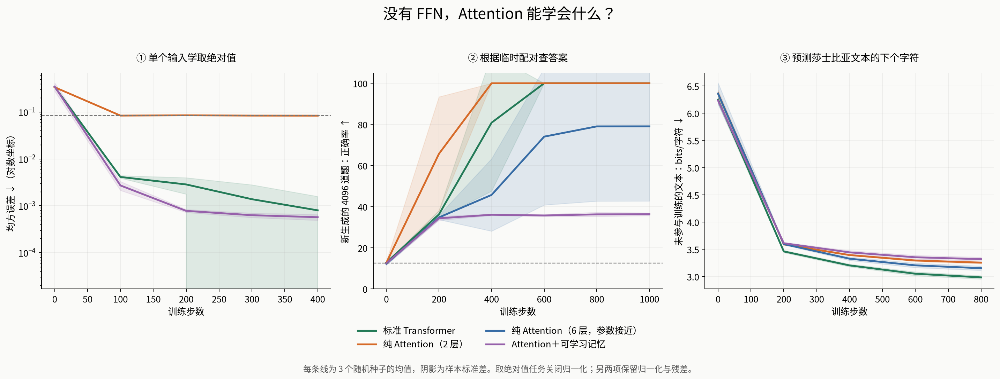

# 试过了：没有 FFN，Attention 也能学会不少东西

2026-10-28，本机 RTX 5070 Ti Laptop，从零训练，无预训练权重。完成 33 次训练，每个设置 3 个随机种子；未针对表现较差的模型追加调参或延长训练。

这次最直观的发现是：**两层纯 Attention 可以完美完成这里的临时查表题，也能学习真实文本的字符规律；但在这次小型语言模型实验里，标准 Transformer 更好。**

这里“纯 Attention”指没有独立 FFN。序列任务仍保留残差、LayerNorm、输入/位置 embedding 和线性输出头。

## 1. 没有 FFN，也能学会查表

每道题随机给出 6 组配对，再问某个 key 对应哪个 value。例如固定评估集的第一题：

```text
8→7，3→4，10→3，13→3，2→0，11→7
问题：10 对应什么？
正确答案：3
两层纯 Attention 的答案：3
```

每次训练重新生成配对，评估集独立固定生成 4096 道题。下面列出三个种子的最终正确率，没有挑选最好一次：

| 模型 | 参数量 | seed 0 | seed 1 | seed 2 |
|---|---:|---:|---:|---:|
| 标准 Transformer，2 层 | 101,824 | 100% | 100% | 100% |
| 纯 Attention，2 层 | 36,032 | 100% | 100% | 100% |
| 纯 Attention，6 层 | 102,080 | 100% | 37.11% | 100% |
| Attention＋可学习记忆，2 层 | 101,568 | 36.21% | 36.99% | 35.67% |

随机猜是 12.5%。另一个更有意义的参照是：完全不看 query，直接猜配对中出现次数最多的 value，也有 36.77% 正确率。因此，**本次加记忆版本的分数不足以表明它学会了准确查表**。仅凭分数不能断定它内部就用了这个具体策略。

六层版本一组种子失败，也说明增加深度和参数并不保证在固定训练预算下更容易学会。这里没有进一步诊断失败原因。

## 2. 纯 Attention 能学文本规律，但这次 FFN 帮了忙

使用约 111 万字符的 Tiny Shakespeare，前 90% 训练、后 10% 评估。每个模型训练 800 步，每步 32×64 个字符目标，共 1,638,400 个训练目标。评估使用固定窗口中的 65,536 个字符目标。

下表“bits/字符”越低越好：可以理解为模型猜下一个字符时，平均还剩多少不确定性。± 是三次运行的样本标准差。

| 模型 | 参数量 | 评估 bits/字符 ↓ |
|---|---:|---:|
| 标准 Transformer，2 层 | 111,360 | **2.984 ± 0.030** |
| 纯 Attention，2 层 | 45,568 | 3.255 ± 0.020 |
| 纯 Attention，6 层 | 111,616 | 3.153 ± 0.039 |
| Attention＋可学习记忆，2 层 | 111,104 | 3.319 ± 0.035 |

简单参照：均匀猜字符为 6.022；只统计训练文本单字频率为 4.831；统计“前一个字符→下一个字符”的频率为 3.579。后两项只用训练集计数，采用加一平滑，并在完全相同的评估目标上计算。

所以两层纯 Attention 确实学到了有用的字符规律。六层版本补回接近标准模型的参数量后，差距缩小，但没有追上标准模型。这不能证明 FFN 在所有设定下都更好：这里只用了一个小数据集、一套共同训练设置，也没有匹配两层与六层模型的计算量。

所有模型生成的内容仍混有大量拼写错误、伪单词，远谈不上连贯写作。`samples.txt` 固定展示各版本 seed 0，用同一提示 `ROMEO:`、温度 0.8 和采样种子 777，没有挑最好看的文本。

## 3. 单个输入时，前面说的限制真的出现了

输入一个 x∈[-1,1]，让模型输出 |x|。这一项关闭所有归一化，保留仿射输入/输出映射与残差，防止 LayerNorm 提供额外的非线性。每个版本训练 400 步，在固定的 1001 点网格评估。

| 模型 | 均方误差 ↓ |
|---|---:|
| 标准 Attention＋FFN | 0.000800 ± 0.000772 |
| 纯 Attention | **0.083524 ± 0.000009** |
| Attention＋可学习记忆 | 0.000571 ± 0.000081 |

在这个对称网格上，最好的仿射函数是输出常数约 0.5005，均方误差 0.083500。纯 Attention 几乎就停在这里：只有一个 key，softmax 恒为 1，整个模型只能学仿射函数，无法弯成 V 形。加入 FFN 或额外的可学习记忆后，模型能学出接近 V 形的曲线。

这只检验“单 token＋无归一化＋仿射输入输出”这一受限结构，不能推广为纯 Attention 模型普遍不能计算绝对值。

## 图




## 结果依据与复跑

代码、数据及设置见 `README.md`。`results/protocol.json` 在正式训练开始前写入，固定任务设置、三组种子、数据 SHA-256 和训练代码 SHA-256。完整逐次指标、模型配置与曲线在 `results/*.json`，33 个最终 checkpoint 在 `results/checkpoints/`。

因果掩码、查表标签、记忆梯度、共享组件初始化与单 token 仿射恒等式检查均通过。每个 checkpoint 保存后都重新加载，并在同一评估集上重算最终分数，最大损失差为 0。事后计算的简单频率参照及前四道固定查表题记录在 `diagnostics.json`；没有据此重新选择或训练模型。

本次结论停留在这三个具体小任务：**独立 FFN 不是网络能否学习的开关；它提供的计算方式，在这里的语言建模任务上确实有帮助。**
